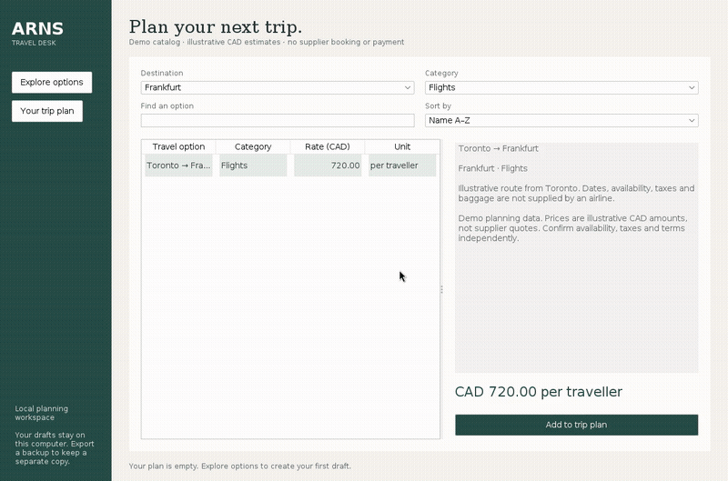

# ARNS Travel Desk

A Java desktop workspace for exploring travel options and keeping a durable trip plan. Browse the original project's eight catalog categories, save planning drafts, revise traveller details and quantities, and track what needs supplier follow-up.

**This is a local planner.** The included catalog is demonstration data with illustrative CAD estimates. No airline, hotel, restaurant, rental, tour operator, or payment provider is connected. Saving or marking a draft does not purchase or confirm a reservation.

## Demo



[Watch the full video](docs/assets/arns-demo.mp4). The walkthrough uses the actual Swing application and a temporary in-memory database, with example traveller details. No purchase or supplier request is made.

## Build and run

Install a **full JDK 17 or newer** with desktop support. Java, not Node.js, is required. The Maven wrapper downloads its pinned build tool and dependencies on first use; the built application then runs locally without network access.

### macOS / Linux

```sh
git clone https://github.com/Hazmat-ai/ARNS_Travel_System.git
cd ARNS_Travel_System
chmod +x mvnw
./mvnw clean verify
java -jar target/arns-travel.jar
```

### Windows PowerShell

```powershell
.\mvnw.cmd clean verify
java -jar target\arns-travel.jar
```

`target/arns-travel.jar` bundles the runtime dependencies. Java must be available on PATH. A headless server cannot display the GUI, but can verify the store:

```sh
java -jar target/arns-travel.jar --check
```

## Using the desk

1. Choose a destination and category. Search by name or description; sort by name or numeric estimate.
2. Select an option, review its pricing unit, and click **Add to trip plan**.
3. Enter the organiser/traveller name, email, date, and quantity. Hotels use nights, cars use days, and the other categories use the displayed unit.
4. Save a draft. In **Your trip plan**, edit or remove drafts, mark selected drafts for follow-up, or cancel local follow-up records.
5. Export a CSV or create a database snapshot. Both refuse to replace an existing file.

All estimates use CAD. Taxes, fees, availability, supplier terms, and foreign-exchange conversion are not modeled. Restaurant amounts are meal-budget estimates, not table-reservation charges. The old 2025 flight/event dates are not presented as current supplier schedules.

## Storage and backups

The database is an embedded H2 file in `~/.arns-travel/travel.mv.db` by default. It is private local state and is not included in Git. To use a different directory:

```sh
java -Darns.dataDir=/path/to/private/arns-data -jar target/arns-travel.jar
```

Use the app's **Backup database** action for a consistent snapshot while it is open. Do not copy the live database file while the app is running. To restore, close every ARNS instance, preserve your current data directory, restore the snapshot into an empty directory, then launch against that directory:

```sh
java -cp target/arns-travel.jar org.h2.tools.Restore -file /path/to/backup.zip -dir /path/to/restored-data -db travel
java -Darns.dataDir=/path/to/restored-data -jar target/arns-travel.jar
```

Keep CSV exports and snapshots private: they contain traveller contact information. The application does not encrypt its database or exports. Use OS account permissions and disk encryption appropriate to your device. One application instance owns a file database; network sharing and multi-user operation are not supported.

## Architecture

| Layer          | Responsibility                                                                    |
| -------------- | --------------------------------------------------------------------------------- |
| `arns.ui`      | Swing screens, accessible controls, typed tables, and background operations       |
| `arns.service` | Validation, catalog search, reservation transitions, exact totals, and CSV export |
| `arns.data`    | Prepared SQL, transactions, optimistic version checks, schema setup, and backups  |
| `arns.model`   | Immutable catalog/reservation records, category units, and integer-cent money     |
| `schema.sql`   | Catalog, contact, reservation, and version tables with constraints and indexes    |

The catalog adapter retains the original project's examples but labels them as unverified. Prices are stored as integer cents; quantities and line totals are derived from typed data. There is no parsing of display strings, reflective modification of private collections, mock checkout, shared server, web API, login service, JWT, or MongoDB subsystem.

See [application contracts](docs/application-contracts.md), [security model](docs/security.md), and [release notes](docs/release.md).

## Tests and verification

```sh
./mvnw verify
```

Tests cover exact money calculations, validation, search, database persistence across reopening, edits and stale versions, multi-row rollback, cancellation, SQL constraints, contact cleanup, CSV injection protection, backup restoration, and form values. `DesktopFlowTest` additionally runs the real GUI when a display is available; it is skipped in a headless environment unless desktop validation is explicitly required.

On Linux with Xvfb:

```sh
xvfb-run -a ./mvnw -Djava.awt.headless=false -Darns.requireDesktop=true -Dtest=DesktopFlowTest test
```

CI builds/tests on Linux, macOS, and Windows and separately requires the Linux desktop flow. A supplied CI matrix is not a claim that all platforms have already passed remotely.

## Upgrading from the original project

The old `src/gui`, `src/model`, `src/services`, and `src/utils` layout is replaced by Maven's `src/main` and `src/test` layout. Generated `bin/` classes and `doc/` Javadoc output are no longer committed. The sponsorship/meme popup and pretend purchase confirmation are removed.

Old reservations were held in memory and cannot be recovered after those sessions closed. `FileManager`'s optional pipe-delimited files are not imported automatically; preserve any such files before replacing an old checkout. The new app never silently treats an unreadable file as an empty reservation store.

This repository is a desktop planning project, not a deployable public travel-booking service. A real supplier integration would need verified inventory/quotes, idempotent booking and cancellation APIs, identity and access control, payment compliance, privacy/retention policy, and provider-specific end-to-end validation before live use.
